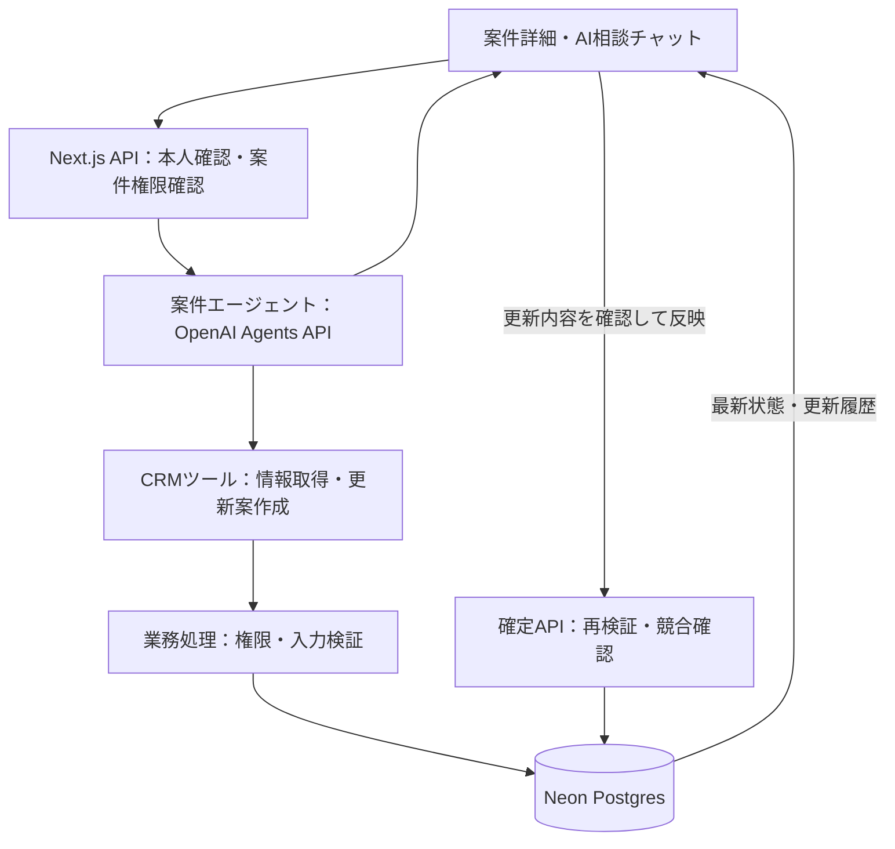

# 案件・商談エージェント構成案

作成日: 2026-09-19 / 設計時の対象コード: `5b780cb`

実装時に利用者指定でDeepSeekへ変更した。以下は当初の設計案。実装済みの構成・設定・制限は [DEAL_AGENT_IMPLEMENTATION.md](./DEAL_AGENT_IMPLEMENTATION.md) を参照。

## 1. 推奨構成

現在の案件・商談（`deals`）を PJ として扱い、案件詳細に「進捗・方針」と「AI相談」を追加する。既存の Next.js / TypeScript / Neon Postgres / Vercel を継続する。

共通の案件エージェントを1種類実装し、案件ごとに参照データ・会話・確定した方針を分ける。案件ごとに別プログラムや常駐プロセスを作る必要はない。

利用体験の中心は「状況を話す → 更新案が出る → 内容を確認して反映 → 同じ案件の続きとして相談する」。方針相談だけの場合は相談として完結し、「方針に採用」した内容を正式な決定事項として保存する。

## 2. 現在あるものと追加するもの

| 領域 | コードから確認した現状 | 追加する構成 |
| --- | --- | --- |
| 案件 | 金額、ステージ、受注確度、受注予定日、担当者、メモ | 目標、現状、進行上の懸念、現在の方針、次回確認日 |
| 活動・タスク | `deal_id` で案件と紐付く | 会話から活動登録・タスク作成／完了を提案 |
| AI | 顧客要約・次アクション提案の単発API。Chat Completions、`gpt-4o-mini` を使用 | 案件の情報取得、会話継続、根拠提示、更新案の保存 |
| 履歴 | `ai_summaries` と一部操作の `audit_logs` | 会話、実行結果、更新差分、方針決定の履歴 |
| 認証 | DBセッション認証がある | API・ツール・更新処理それぞれの認証／案件権限確認 |

参照した主なファイル: `lib/ai/`、`lib/db/queries/`、`lib/auth/session.ts`、`app/api/ai/`、`app/(crm)/deals/[dealId]/page.tsx`、`proxy.ts`、`scripts/db/migrate.sql`。

本案はリポジトリの調査に基づく。本番DBの実スキーマ、OpenAIの利用権限、デプロイ環境の制限は未検証。

## 3. 画面と使い方

案件詳細を、左側に案件情報・進捗・タスク、右側に相談チャットを置く構成にする。狭い画面ではタブで切り替える。既存のデザイントークンを使用する。

| 操作 | 入力例 | エージェントの応答・反映内容 |
| --- | --- | --- |
| 進捗更新 | 「今日の打合せで提案内容に合意。見積は来週火曜までに提出」 | 活動履歴、現状要約、見積タスクの追加案。日時・担当者が曖昧なら確認 |
| 方針相談 | 「価格がネック。値引きか段階導入か相談したい」 | 根拠となる履歴、選択肢、利点・欠点、推奨案、確認すべき情報 |
| 方針採用 | 「段階導入で進める。この方針を保存して」 | 決定事項と理由、現在の方針、次アクションの更新案 |
| 状況確認 | 「前回から何が変わった？」 | 確定済み更新と活動履歴の差分。参照した記録へのリンク |
| 横断確認（後続） | 「今週フォローが必要な案件は？」 | 閲覧可能な案件から、期限超過・未更新・未完了タスクを抽出 |

更新案はカードで「対象」「変更前→変更後」「理由」「根拠」を表示し、編集・反映・却下を選べる。相談の回答と、DBへの反映が完了した通知を明確に区別する。

受注確度は成約の見込みを示す既存項目として維持する。進捗率として流用しない。初期版の進捗は「ステージ・現状要約・未完了タスク・次回確認日」で表し、任意の進捗％は追加しない。

## 4. 全体構成



AIの役割は、必要な情報を集め、状況を整理し、相談に答え、構造化された更新案を作ること。DB更新の成否はアプリの業務処理が確定する。

## 5. エージェント実行基盤

推奨候補は OpenAI Agents API と OpenAI-hosted 環境。セッションを続けられる実行基盤を利用し、CRM側に業務データと適用履歴を保存する。公式資料でセッション継続とホスト環境を確認済み。[概要](https://developers.openai.com/api/docs/guides/agents-api/overview)、[Quickstart](https://developers.openai.com/api/docs/guides/agents-api/quickstart)。

CRMへのアクセスは、Next.js側に実装する限定的なMCPツールのHTTPS入口を第一候補とする。これによりブラウザの接続とは別にツール要求を処理できる。DB接続情報を実行環境へ渡さず、各要求で案件と利用者の権限を確認する。[MCP接続の公式資料](https://developers.openai.com/api/docs/guides/agents-api/tools/mcp)。

最初の接続検証で API 利用権限、対応モデル、MCP認証、Vercel上の要求処理を確認する。モデル名は設定値として管理し、日本語の案件相談・更新案抽出の評価結果で決める。既存の単発AI機能は段階的に共通化する。

ブラウザを閉じた後も結果を回収できるよう、実行IDを先に保存し、署名を検証したWebhookと再照合処理で状態を保存する。Webhookの重複・順序逆転を許容し、取得した実行状態を基準にする。ストリームは画面表示用とし、再接続時は保存済み結果を取得する。[セッションWebhookの公式資料](https://developers.openai.com/api/docs/guides/agents-api/sessions/webhooks)。

## 6. ツールと更新の境界

| ツール・処理 | 対象 | 初期版の扱い |
| --- | --- | --- |
| `get_deal_context` | 案件、顧客の基本情報、現在の方針 | 権限のある案件を読み取る |
| `list_deal_activities` | 当該案件の活動履歴 | 期間・件数を指定して読み取る |
| `list_deal_tasks` | 当該案件のタスク | 状態・期限で絞り込む |
| `list_deal_decisions` | 採用済み方針とその理由 | 有効な決定と過去の変更を読む |
| `propose_deal_changes` | 案件更新、活動、タスク、方針の変更案 | 検証済み下書きを保存する |
| `apply_deal_changes` | 確認済みの変更案 | ログイン利用者が画面から呼ぶ確定API |

案件ID・利用者IDはサーバー側の実行コンテキストに固定する。モデルが指定したIDだけを信用しない。任意SQL実行、汎用URLアクセス、メール送信のツールは初期版に含めない。

初期版のDB更新は、進捗・タスク・活動履歴を含めて差分確認後に反映する。金額、受注確度、受注／失注、期限の変更も同じ確認カードに明示する。利用が安定した後、利用者が明示的に許可した範囲の活動記録追加などを自動反映の候補にできる。

## 7. データ設計

既存 `deals`、`activities`、`tasks`、`files`、`audit_logs` を継続利用し、独立した `projects` テーブルは追加しない。

| 追加・拡張 | 保存内容 |
| --- | --- |
| `deal_contexts`（`deal_id` が主キー） | `objective`、`current_summary`、`health`、`blockers`、`current_strategy`、`next_review_date`、`version`、更新者・日時 |
| `deal_decisions` | 決定内容、理由、検討した選択肢、根拠の記録ID、決定者、決定日、置き換え元の決定ID |
| `agent_threads` | `deal_id`、開始者、タイトル、外部セッションID、会話要約、アーカイブ日時 |
| `agent_messages` | スレッド、発言者、本文、参照元ID、作成日時。業務上の会話とツール結果を保存 |
| `agent_runs` | スレッド、起動者、外部ターンID、実行状態、リクエストID、モデル、利用量、エラー分類 |
| `agent_change_requests` | 実行ID、対象案件、型付き変更内容、変更前の版、提案者、確認者、状態、適用結果 |
| `agent_tool_grants` | 実行に紐づく限定アクセス権、トークンのハッシュ、有効期限、失効日時 |
| 既存の更新対象テーブル | 競合検出用の `version` を追加。手動編集・グリッド編集・エージェント経由の全更新で増分 |

`health` は `unknown / on_track / at_risk / blocked` を候補とし、成約ステータスと区別する。初期値は不明とする。古い案件をAIの推測で一括補完しない。

会話は複数スレッドを作成できる。初期版は案件閲覧権限に従う案件共有の会話とし、画面に共有範囲を表示する。外部セッションはスレッド単位とし、案件をまたいで使い回さない。

## 8. 情報の記憶と根拠

回答時の情報は「最新の案件状態 → 有効な決定事項 → 関連する活動・タスク → 会話要約と直近発言」の順に組み立てる。毎回最新DBを確認し、古い会話要約で現在の値を上書きしない。

確定した業務状態の正本はNeonとする。会話要約は文脈の補助であり、決定事項には昇格させない。方針相談の未採用案は会話に残し、採用した内容のみ `deal_decisions` に記録する。

回答には根拠の活動・タスク・決定へのリンクと参照時点を付け、事実・推測・不足情報を区別する。同じ会社に紐づく別商談の履歴は自動で混在させない。会社共通の情報を使う場合は出所を明示する。

初期版は構造化DB検索で十分な範囲に絞る。現在の `files` はURL登録であり、ファイル本文の検索・読解は未実装。議事録PDFなどの検索は後続で本文抽出と検索索引を追加する。

## 9. 更新処理の流れ

1. メッセージとリクエストIDを保存し、ログイン利用者・対象案件を確認する。
2. 案件と関連情報を取得し、更新案を構造化する。日付・対象・担当者が特定できない場合は確認する。
3. アプリ側でスキーマ、更新可能フィールド、対象の所属を検証し、差分カードを保存・表示する。
4. 利用者がカードを確認・編集して「反映」を選ぶ。編集した場合は差分を再計算する。
5. 確定APIでセッションと権限を再確認し、変更前の `version` と現在値を比較する。
6. 一連の更新、活動／タスク追加、変更案の適用済み化、監査ログを同一DBトランザクションで保存する。
7. 成功したレコードIDと最新状態を返し、画面を更新する。競合時は書き込まず最新差分の再確認を求める。

変更案IDの一意制約・状態遷移で二重反映を防ぐ。通信切断時も同じIDで結果を照会し、AI処理や書き込みを無条件に再実行しない。誤反映の取り消しは新たな訂正操作として記録する。

## 10. 既存実装で先に整える点

- `proxy.ts` は `/api/` を認証ゲートから除外しており、既存AIルート内にもセッション確認がない。新旧AI APIの入口で本人確認を行う。
- `lib/actions/tasks.ts` などの既存更新処理には、関数内の本人・案件権限確認がない。エージェントと手動UIが共通利用するサービス層に検証と監査を集約する。
- PJ単位の権限モデルは現状未実装。初期方針は「有効な社内ユーザーは閲覧可、admin は全件更新可、member は担当案件を更新可、viewer は参照・相談のみ」とする。既存手動編集にも同じ方針を適用し、担当者未設定の案件は管理者が割り当てる。共同担当が必要になった時点で `deal_members` を追加する。
- `scripts/db/migrate.sql` には認証コードが使う追加ユーザー列や `user_sessions` の定義が見当たらない。本番DBとの差を調査し、順序付きマイグレーションと適用履歴を整備してから追加テーブルを導入する。

## 11. 配置案

```text
app/(crm)/deals/[dealId]/page.tsx             案件詳細へ進捗・相談を統合
app/api/deals/[dealId]/agent/route.ts         会話開始・メッセージ送信
app/api/agent/runs/[runId]/route.ts           実行状態・結果の取得
app/api/agent/changes/[changeId]/apply/route.ts 更新案の確定
app/api/agent/mcp/route.ts                   限定CRMツールの入口
app/api/agent/webhooks/route.ts              実行完了通知と再照合
components/agent/DealAgentPanel.tsx          相談チャット
components/agent/ChangeProposalCard.tsx     差分・編集・反映
components/deals/DealProgressPanel.tsx      進捗・方針・次回確認日
lib/agent/runtime.ts                       API接続とセッション管理
lib/agent/context.ts                       案件コンテキストの組み立て
lib/agent/tools.ts                         ツール定義と入力検証
lib/services/deal-operations.ts            手動／AI共通の業務更新
lib/auth/deal-permissions.ts               案件の閲覧・更新権限
lib/db/queries/agent.ts                    会話・実行・変更案の保存
lib/validation/agent.ts                    変更案とAPI入力のスキーマ
scripts/db/migrations/                     順序付きの差分マイグレーション
```

## 12. 導入順と完了条件

| 段階 | 実装範囲 | 完了条件 |
| --- | --- | --- |
| 0: 接続と基盤 | API利用確認、DB差分確認、API認証、共通権限・更新処理 | 対象案件の取得ができ、権限外の取得・更新が拒否される |
| 1: 案件相談 | チャット、案件情報取得、会話保存、根拠リンク、再接続 | 実案件の現状と方針を根拠付きで相談でき、続きの会話ができる |
| 2: 進捗更新 | 差分カード、活動・タスク・進捗・方針の反映、監査 | 会話から更新でき、競合・二重送信で誤更新しない |
| 3: 横断支援 | 案件横断の滞留確認、週次サマリー、資料検索 | 閲覧範囲の案件だけを扱い、指摘の根拠を追える |

最初のリリースは段階0〜2。「1案件で進捗を伝える、更新案を反映する、後日その内容を踏まえて方針を相談する」を一連で成立させる。

検証には日本語の実例を匿名化して使い、曖昧な案件名・日付、古い履歴、同一顧客の別案件、相反する方針、権限なし、同時編集、二重反映、接続切断、API失敗を含める。型チェック・lint・buildに加え、この業務フローを画面から確認する。

コストは実行単位でモデル・トークン・所要時間を記録する。初期は利用者ごとの回数制限、入力件数上限、ツール呼出回数上限、実行時間上限を設ける。金額の見積りは利用モデルと相談回数が決まってから行う。

定期レビューは段階3でアプリ側のスケジューラーとして追加する。本案作成時点では定期処理の登録、DB変更、APIキー設定、実装・デプロイは行っていない。
